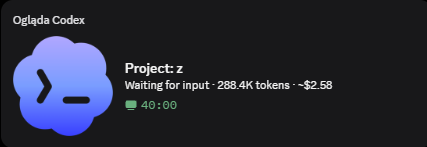

# Codex Discord Presence

Show your current OpenAI Codex project, activity, token usage, and estimated API cost on your Discord profile. The card includes a session timer and shows the model, reasoning effort, and plan in the icon tooltip when those details are available.

The card uses Discord's **Watching** activity type. Find it under **Profile → Activity**. The example shows `Project: z`, the name of the working folder for that session.

## Install

You need Node.js 18+, desktop Discord, and a local Codex build with lifecycle hooks. Git is optional for detecting repository names.

Download the ZIP for your system, extract it, and run the installer in a terminal.

| Platform | Download | Command |
| --- | --- | --- |
| Windows | [Windows ZIP](https://github.com/MarcelBaka/codex-discord-presence/releases/latest/download/codex-discord-presence-windows.zip) | `.\install.cmd` |
| macOS | [macOS ZIP](https://github.com/MarcelBaka/codex-discord-presence/releases/latest/download/codex-discord-presence-macos.zip) | `./install.command` |
| Linux | [Linux ZIP](https://github.com/MarcelBaka/codex-discord-presence/releases/latest/download/codex-discord-presence-linux.zip) | `./install.sh` |

1. Start desktop Discord and enable activity sharing under **Activity Privacy**.
2. In Codex CLI, open `/hooks` and trust the **Codex Discord Presence** entries.
3. Start a fresh Codex session and check your Discord profile under **Activity**.

The installer prints the path to the command launcher. You can also run `node app/cli.js install` from the extracted folder. Add `--autostart` for login startup. With the default settings, a trusted Codex hook starts the background process on demand. The installer preserves existing hooks and backs up the hook file when it changes it.

The bundled Discord application ID `1574523878280007710` supplies the **Codex** name and icon. For your own Discord application, run `set-app-id <ID>` and manage its name and icon in Developer Portal.

From a checkout use `node app/cli.js <command>`. You can use the absolute launcher path printed at install time after removing the checkout, or `codex-presence <command>` after linking the checkout with `npm link`.

### Codex Desktop and VS Code

These clients need local session files and access to the same trusted user-level hooks. Review the hooks in the client if it offers a hook settings screen, then start a fresh thread. A conversation that was already open during setup may need a client reload. Codex CLI is the directly tested setup.

## Commands

| Command | Action |
| --- | --- |
| `status` | Show the current Discord activity, acknowledgement, and token sources and totals. |
| `doctor` | Check Codex, its hook file, the process query, and Discord IPC. |
| `logs`, `version` | Read the bounded local log or print the installed version. |
| `disable`, `enable` | Clear and stop presence, or enable it again. |
| `pause [30m\|1h\|forever]`, `resume` | Temporarily clear activity and later restore it. The default pause is 30 minutes. |
| `alias <project> <alias\|default>` | Rename a project on the card or remove the alias. |
| `hide [on\|off]` | Hide all project names. |
| `set-app-id <ID\|default>` | Set or reset the Discord application ID. |
| `autostart on\|off` | Manage a login entry. |
| `update [--main\|vX.Y.Z]` | Install the latest release, main, or a specific release. |
| `auto-update on\|off` | Check daily for newer stable releases when the daemon is running and there are no active sessions. |
| `uninstall` | Clear activity and remove the integration files and hooks. Original hook backups are retained. |

Windows uses a hidden Startup script, macOS a LaunchAgent, and Linux an XDG Autostart entry. Private repository downloads use an authenticated GitHub CLI when available. The optional `CODEX_PRESENCE_GITHUB_TOKEN` can also be set in the environment. No Discord or OpenAI credentials are needed.

## What appears on the card

- The application name from Discord, using **Watching** so the activity can coexist with VS Code's Playing activity.
- The working directory's Git root name or main checkout name for a linked worktree. Outside Git it uses the working directory's basename.
- The latest user's prompt or newly started session selects the project. Resuming an old session leaves a more recently used project selected until a new prompt is sent.
- The native elapsed timer uses the CLI process start. IDE clients can share an app-server, so those sessions use the first trusted hook for that logical session. The timer is preserved through Discord and daemon reconnections.
- Applying patches, running shell tools, browsing, waiting for approval and waiting for the next prompt are displayed where Codex emits the matching hook or rollout event. Some tools, including certain hosted tools, do not emit tool hooks.
- Session and local-calendar-day totals alternate every 15 seconds. Project names and plan can be hidden in the [example config](config.example.json).

## Usage and pricing

The reader follows rollout JSONL files under `CODEX_HOME/sessions` and `archived_sessions`. Current Codex versions persist per-response `token_usage_record` events and `event_msg/token_count` snapshots. Response IDs deduplicate records. A cumulative snapshot contributes only its increase over the previous total, and a snapshot paired with a response record contributes zero additional tokens. The first snapshot uses `last_token_usage` when available to avoid treating imported history as a request. Model and effort come from turn metadata. Plan may be present as `rate_limits.plan_type`. The parser handles partial records and resets its reader after a detected rewrite or truncation. Codex treats the rollout format as internal and it may change between versions.

For example, cumulative input of 46,721, cached input of 36,864, and output of 274 produce **10,131 tokens** on the card. The next total is used as a new snapshot. Reasoning tokens are part of output. The session sums records at or after the current session start, even when a conversation is resumed. `status` includes the full observed conversation total separately. The Today total uses the same activity records after local midnight across discovered rollouts. A missing source shows **Tokens: no data**.

Estimates use the model's dated Standard OpenAI API prices. Uncached input, cache hits, cache writes, and output are charged once each at their respective rates. The 30-minute cache-write rate is used when the transcript does not identify a TTL. When some records lack pricing, the card labels the estimate as partial and includes all observed tokens in the count. If no records have a rate, only the token count appears. Pricing is checked daily against the repository, with the bundled JSON available offline. These are API-equivalent estimates. Codex subscriptions use their own accounting.

## Local data and lifecycle

Hook output is silent. Tool hooks queue an event type, time, IDs, and a small fixed tool category. The integration reads only the local metadata it needs to compute activity and never opens Codex credentials. The payload contains the project basename or alias, state, aggregate counts and price, timestamp, and optional icon metadata. Logs contain fixed diagnostic messages. The daemon uses a per-installation IPC endpoint, checks owner PID and process creation time, reconnects to desktop Discord with backoff, and rate-limits to five updates per rolling 20 seconds. Discord only receives changed activity or the current activity on reconnect.

With a shared app-server, switching views may leave a thread open, as described in [Codex hooks](https://learn.chatgpt.com/docs/hooks). Closing the session or exiting the owner process clears it. Sessions already open before installation need to start a new thread or submit a prompt after the hooks are trusted. Status can be limited when a client does not expose local rollout files, cannot start hooks, or runs in a different environment such as WSL. In WSL, Windows Discord IPC requires an additional bridge and is outside this project.

## Troubleshooting

- **No card in Discord.** Run `doctor` to check desktop Discord IPC and the hook setup, then run `status` while a Codex session is open to check whether Discord acknowledged the activity.
- **No token count.** The card says **Tokens: no data** until a local rollout contains usable token records.
- **Partial cost.** The estimate covers records with a published API rate. The token count includes all observed records.

## Development

Run `npm test`. Tests use a mock Discord server and Codex-like processes executing the installed commands. The GitHub workflow covers Windows x64, macOS arm64 and Intel, Ubuntu x64 and arm64, and Node 18, 22, and 24. A pushed version tag runs the matrix, verifies the version and changelog, and publishes the installer ZIPs.

## License

[MIT](LICENSE)
